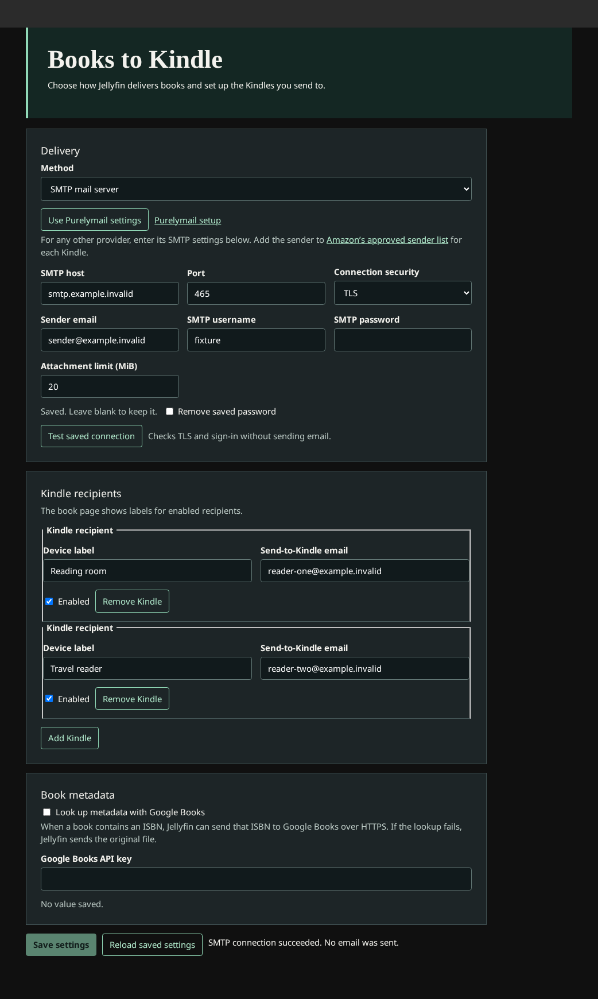
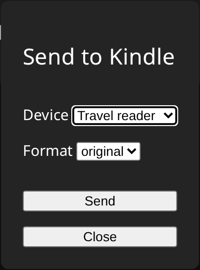

# Books to Kindle for Jellyfin

<a href="docs/assets/reading-jacket-v2-still.svg" title="Open the still illustration">
<picture>
  <source media="(prefers-reduced-motion: reduce)" srcset="docs/assets/reading-jacket-v2-still.svg">
  
</picture>
</a>

Send EPUB and PDF books from Jellyfin Web to your Kindle through your own mail provider. Choose a device by name and fill in missing EPUB credits before the book leaves Jellyfin.

[Install on Jellyfin 12.4](#install) · [Download v2.0.0.1](https://github.com/adambkovacs/jellyfin-send-to-kindle/releases/tag/v2.0.0.1) · [Set Kindle access](#kindle-access) · [Project site](https://adambkovacs.github.io/jellyfin-send-to-kindle/) · [Delivery API](docs/delivery-v1.md)

## Fill in missing EPUB credits before sending

Books to Kindle can use an EPUB's ISBN to look up its author in Google Books and add the credit to the copy you send. It can also fill in a missing publisher or subject from the same record.

<a href="docs/assets/edition-proof-v2-still.svg" title="Open the still illustration">
<picture>
  <source media="(prefers-reduced-motion: reduce)" srcset="docs/assets/edition-proof-v2-still.svg">
  
</picture>
</a>

In **SMTP mail server** mode, open **Book metadata**, enable Google Books lookup, and enter your Google Books API key. The plugin sends the ISBN to Google Books and checks the returned ISBN and title against the EPUB on your server. It fills missing author, publisher and subject fields and sends the original if it cannot confirm a single match. Existing fields are preserved, including empty metadata placeholders. Your library file stays intact, and PDFs go through as supplied.

<details>
<summary>What did the Jev book identification trial show?</summary>

In a separate PDF trial, TypeSafe Jev identified the work from its title and author. The two ISBNs in the evidence belonged to the hardcover and EPUB, so Jev left the PDF edition unresolved. A direct catalog comparison reached the same conclusion. This was an identification experiment. The released plugin uses Google Books for EPUB enrichment and has no Jev setting.

</details>

## Install

Use Jellyfin Server 12.4.0 with Jellyfin Web. In **Dashboard → Plugins → Repositories**, add both catalog URLs.

```text
https://www.iamparadox.dev/jellyfin/plugins/manifest.json
https://adambkovacs.github.io/jellyfin-send-to-kindle/manifest.json
```

1. Install **File Transformation 3.0.3.0** and **Books to Kindle 2.0.0.1**. Restart Jellyfin. [File Transformation release](https://github.com/IAmParadox27/jellyfin-plugin-file-transformation/releases/tag/3.0.3.0)
2. Open **Dashboard → Plugins → My Plugins → Books to Kindle**. Choose **SMTP mail server**, enter your provider's SMTP settings, and add a label and Send-to-Kindle address for each device. Save the settings and select **Test saved connection**.
3. Add your sender to Amazon's **Approved Personal Document Email List** for each Kindle. [Amazon sender approval](https://digprjsurvey.amazon.com/csad/help/node/GX9XLEVV8G4DB28H)
4. Sign in to Jellyfin Web with an account that can download the book and send to the Kindle. Open the book, select **Send to Kindle**, choose a device, and select **Send**.

<details>
<summary>View the SMTP settings</summary>



</details>

### Upgrade, install manually or roll back

Version 2 has its own plugin ID. Before switching from v1 or upstream, back up your plugin settings privately and finish or reconcile pending sends. Uninstall the previous version and restart Jellyfin because both versions use the same Web action and routes.

Enter SMTP settings and devices in the new dashboard. If you use an external delivery service, keep its job store and set the service URL, token and identity-header name for version 2 before switching.

For a manual install, download the Books to Kindle ZIP and the File Transformation ZIP for Jellyfin 12.4. Stop Jellyfin, extract each ZIP into a separate versioned folder in the plugins directory, then start Jellyfin.

To roll back, uninstall version 2 and restart. Restore the previous version and its settings if needed. [Jellyfin plugin guide](https://jellyfin.org/docs/general/server/plugins/)

## Kindle access

In **SMTP mail server** mode on 2.0.0.1, an administrator can choose who can use each device. In the plugin dashboard, open **Kindle recipients**, select accounts under **Jellyfin users** for the device, and save.

- Leave the list empty to allow Jellyfin administrators only.
- Select specific accounts to grant access to those accounts. Include your administrator account if you want to send to that Kindle.

Readers need permission to see and download the book. The chooser lists enabled Kindles they can use.

Version 2.0.0.0 restricts sending to Jellyfin administrators. **External delivery service** mode still requires a Jellyfin administrator and applies the service's access checks.

## Configure your mail provider

| Setting | Purelymail | Other SMTP providers |
| --- | --- | --- |
| Server | `smtp.purelymail.com` | Your provider's authenticated outgoing mail host |
| Connection | Port 465 with TLS, or 587 with STARTTLS | Your provider's port and TLS mode |
| Credentials | Full mailbox address and SMTP-scoped app password | SMTP username and password or app password |
| Sender | An address the mailbox can send from | An address the provider and Amazon approve |

The plugin uses outgoing mail. **Test saved connection** checks the connection and authentication without sending a book. Choose a provider that supports your installation's SMTP authentication. [Purelymail settings](https://support.purelymail.com/support/solutions/articles/159000430778-server-settings-imap-smtp-pop3-and-managesieve-protocols) · [Purelymail app passwords](https://purelymail.com/docs/twoFactorAuthentication)

## Sending and delivery status

Select **Send to Kindle** on the book page, then choose a device.

[](docs/assets/book-action.png)

[](docs/assets/chooser.png)

Administrators manage recipient addresses and credentials in the dashboard. Disable a device to remove its label from the chooser.

Password and API key fields are write-only. Protect the Jellyfin data directory and its backups.

In SMTP mode, receipts stay on disk so retries can recover after a restart. Receipt storage grows with use.

To use **External delivery service** mode, set `KINDLE_DELIVERY_BASE_URL` and `KINDLE_DELIVERY_TOKEN` on the Jellyfin server. Select the mode in the plugin dashboard.

The service supplies devices, formats and job status. Configure metadata lookup, conversion and identification on the service. [Delivery API contract](docs/delivery-v1.md)

**Accepted by mail provider** confirms SMTP submission. Open the document in the Kindle library to verify delivery.

After a lost response, use **Retry** or **Check previous request** in the same browser tab to recover the same job. An independent tab has its own request history. If the earlier request is unavailable, verify delivery before sending again. An **unknown** status means the mail provider may have accepted the message. Check the receiving side before sending again.

## Troubleshooting

- If the button is missing, confirm File Transformation is active and refresh Jellyfin Web. Open a book you can download. In SMTP mode, check that you can use an enabled Kindle. In external delivery service mode, sign in as an administrator.
- If the connection test fails, check your provider's port and TLS settings, certificate trust, and whether you need an app password.
- If your mail provider accepted the message and the book is missing, check the Kindle address and attachment size. Confirm Amazon approved your sender and look for a rejection notice.

## Build

Install the .NET 10 SDK and run the build and tests.

```sh
dotnet build -c Release
dotnet test
```

## Upstream and license

Books to Kindle is a fork of vitorpy/jellyfin-send-to-kindle, based on upstream v1.0.0.5. Both projects use the GNU General Public License, version 3 or later. [Upstream repository](https://github.com/vitorpy/jellyfin-send-to-kindle) · [Upstream release](https://github.com/vitorpy/jellyfin-send-to-kindle/releases/tag/v1.0.0.5) · [License notice](LICENSE) · [Full GPL text](COPYING)

The November 2026 releases added Jellyfin 12.4 support, a device and format chooser, per-device access and retry handling. AI coding agents contributed most of the fork's development.

The website uses original generated artwork. [Website fonts and licenses](docs/assets/fonts/)
